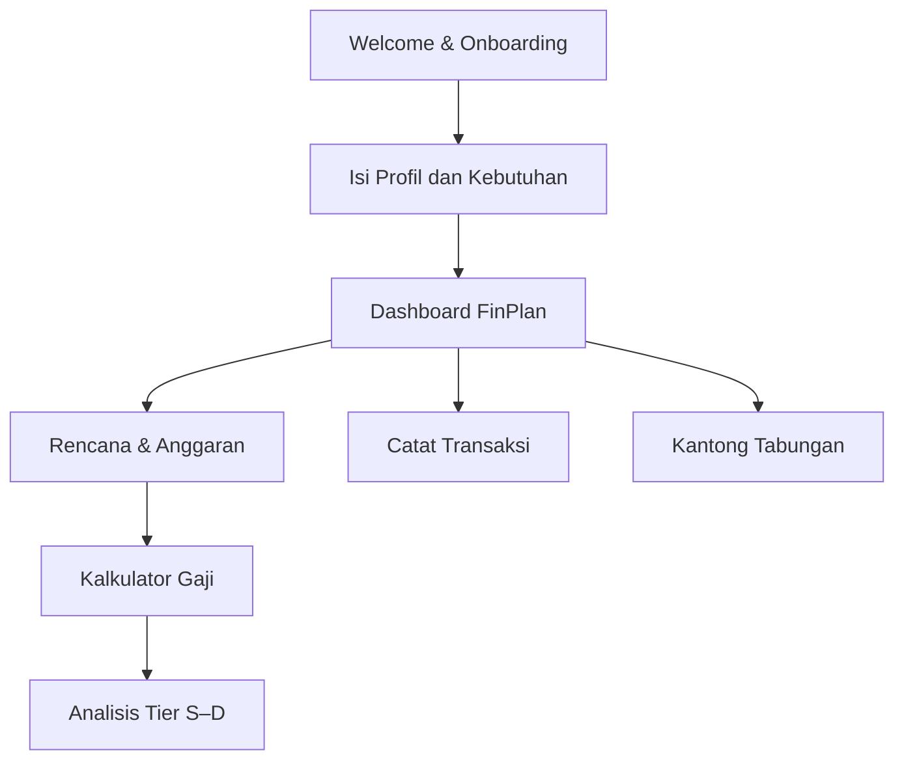

# 💚 FinPlan

### Your Personal Finance Partner

**Rencanakan penghasilan, pahami kebutuhan, catat transaksi, dan capai tujuan keuangan dalam satu aplikasi.**


FinPlan adalah aplikasi perencanaan keuangan pribadi berbasis **Flutter** yang membantu pengguna mengelola uang secara lebih terarah. Aplikasi ini dirancang agar fleksibel: kebutuhan, jadwal kerja, transportasi, dan target keuangan setiap orang bisa berbeda.

FinPlan tidak hanya mencatat pengeluaran, tetapi juga membantu menjawab pertanyaan seperti:

- *Apakah penghasilanku cukup untuk kebutuhan setiap bulan?*
- *Berapa uang yang sebaiknya disiapkan untuk makan, transportasi, tagihan, dan tabungan?*
- *Sudah sejauh mana progres target tabunganku?*
- *Apakah tawaran pekerjaan baru sesuai dengan kebutuhan hidup dan waktuku?*

> **Status proyek:** masih dalam pengembangan. Fitur, desain, dan struktur kode dapat berubah seiring pembaruan.

---

## ✨ Fitur Utama

### 🏠 1. Dashboard Keuangan

- Ringkasan kondisi keuangan dan rencana anggaran bulanan.
- Visualisasi alokasi anggaran menggunakan diagram donat.
- Informasi pemasukan, kebutuhan, tabungan, dan dana cadangan.
- Tampilan ringkas untuk membantu pengguna memahami pembagian uang.

### 🧩 2. Planner — Rencana & Anggaran

Buat perencanaan yang mengikuti rutinitasmu, bukan sebaliknya.

- **Penghasilan:** gaji utama serta pemasukan tambahan dengan frekuensi berbeda.
- **Kebutuhan rutin:** tempat tinggal, tagihan, kebutuhan pribadi, dan kebutuhan khusus buatan pengguna.
- **Anggaran makan:** dapat disesuaikan untuk setiap hari, Senin sampai Minggu.
- **Transportasi:** mendukung rencana perjalanan pergi dan pulang dengan beberapa moda transportasi.
- **Tabungan dan cadangan:** tetapkan jumlah tabungan serta persentase dana cadangan.
- **Ringkasan pembagian gaji:** melihat kebutuhan minimum, anggaran ideal, dan selisih rencana.

### 💸 3. Pencatatan Transaksi

- Catat **pemasukan** dan **pengeluaran**.
- Tambahkan tanggal, nominal Rupiah, kategori/sumber dana, dan keterangan.
- Kelola sumber dana seperti bank, dompet digital, atau tunai.
- Lihat ringkasan transaksi berdasarkan periode.
- Edit dan hapus transaksi dengan konfirmasi.
- Muat riwayat transaksi secara bertahap agar daftar tetap nyaman digunakan.

### 🎯 4. Kantong Tabungan

Kelola beberapa tujuan menabung dalam satu tempat, misalnya dana darurat, pendidikan, perjalanan, atau kebutuhan masa depan.

- Buat kantong dengan nama, emoji, deskripsi, dan nominal target.
- Tentukan tenggat waktu jika diperlukan.
- Pantau progres tabungan.
- Catat penambahan atau pengambilan dana secara manual.
- Lihat riwayat pergerakan saldo kantong.
- Arsipkan dan pulihkan kantong yang tidak aktif.

### 🧮 5. Kalkulator Gaji — *Is This Job Worth It?*

Simulasikan tawaran pekerjaan berdasarkan **penghasilan, biaya bekerja, kebutuhan hidup, waktu, dan preferensi pribadi**.

Pengguna dapat mengisi:

1. **Penghasilan:** pembayaran bulanan, harian, per jam, atau per sesi; tunjangan dan potongan.
2. **Jadwal:** hari kerja, hari ke kantor, serta jam kerja.
3. **Perjalanan:** ongkos, durasi, dan jarak pergi-pulang.
4. **Biaya kerja tambahan:** misalnya makan ekstra, parkir, atau kebutuhan kerja lain.
5. **Kebutuhan hidup:** otomatis mengambil anggaran dari Planner atau diisi manual.
6. **Prioritas pribadi:** target uang tambahan, batas nyaman perjalanan, prospek karier, dan kenyamanan kerja.

#### Sistem Penilaian Tier S–D

| Tier | Makna | Gambaran Umum |
| :---: | --- | --- |
| 🟢 **S** | Sangat worth it | Sangat sesuai dengan kebutuhan dan prioritas pengguna. |
| 🟩 **A** | Worth it | Menarik dengan sebagian besar kebutuhan terpenuhi. |
| 🔵 **B** | Cukup worth it | Layak dipertimbangkan, tetapi masih ada kompromi. |
| 🟠 **C** | Perlu dipikirkan | Ada kebutuhan atau target penting yang belum optimal. |
| 🔴 **D** | Kurang worth it | Terdapat risiko atau ketidaksesuaian yang perlu diperhatikan. |

Penilaian simulasi mempertimbangkan lima aspek:

| Aspek | Bobot |
| --- | ---: |
| Kemampuan memenuhi kebutuhan dan target keuangan | **50%** |
| Waktu perjalanan | **20%** |
| Beban jam kerja | **10%** |
| Peluang berkembang | **10%** |
| Kenyamanan pekerjaan | **10%** |

Terdapat aturan tambahan agar hasil tidak terlalu optimistis ketika biaya bekerja atau kebutuhan pokok tidak tertutup. Pengguna juga bisa melihat **alasan di balik tier** dan rincian perhitungannya.

> **Penting:** Tier S–D adalah indikator simulasi berdasarkan data dan preferensi yang dimasukkan pengguna, **bukan penilaian objektif, jaminan kelayakan pekerjaan, ataupun nasihat keuangan profesional**.

### 💼 6. Pengelolaan Tawaran Kerja

- Simpan dan kelola informasi tawaran pekerjaan.
- Lihat daftar tawaran yang pernah dicatat.
- Edit atau hapus data tawaran sesuai kebutuhan.

### 📆 7. Simulasi Sisa Uang

Membantu memperkirakan penggunaan uang yang tersisa hingga tanggal gajian berikutnya, termasuk pertimbangan kebutuhan makan, transportasi, dan kebutuhan lain.

### ⚙️ 8. Personalisasi & Aksesibilitas

- **Light Mode:** selalu menggunakan tema terang.
- **Dark Mode:** selalu menggunakan tema gelap.
- **Ikuti Sistem HP:** menyesuaikan tema perangkat secara otomatis.
- **Ukuran teks fleksibel:** dapat diperbesar melalui pengaturan aplikasi.
- Desain responsif untuk layar ponsel serta ukuran tulisan yang lebih besar.
- Pengaturan profil dan foto profil yang disimpan secara lokal.

---

## 📱 Alur Penggunaan



Navigasi utama aplikasi terdiri dari **Home**, **Planner**, **Transaksi**, dan **Profil**. Pengaturan aplikasi dapat diakses melalui bagian profil.

## 🛠️ Teknologi

| Teknologi | Penggunaan |
| --- | --- |
| **Flutter & Dart** | Antarmuka dan logika aplikasi seluler. |
| **Material Design 3** | Komponen dan sistem tema terang/gelap. |
| **SQLite (`sqflite`)** | Penyimpanan transaksi di perangkat. |
| **Shared Preferences** | Penyimpanan rencana, preferensi, dan beberapa data aplikasi lainnya. |
| **Image Picker** | Memilih foto profil dari perangkat. |
| **CustomPainter** | Visualisasi alokasi anggaran di dashboard. |

### Struktur Kode Utama

```text
lib/
├── main.dart                # Inisialisasi dan navigasi aplikasi
├── core/                   # Utilitas, termasuk format Rupiah
├── data/                   # Repository dan akses data lokal
├── models/                 # Model data keuangan
├── screens/                # Halaman-halaman aplikasi
├── state/                  # Controller dan state aplikasi
└── widgets/                # Komponen dan formulir yang digunakan ulang
```

---

## 🚀 Menjalankan Project

### Persyaratan

- Flutter SDK dan Dart SDK.
- VS Code atau Android Studio.
- Android SDK yang telah dikonfigurasi.
- Emulator Android atau perangkat Android untuk pengujian.

### Instalasi

1. Clone repository:

   ```bash
   git clone https://github.com/Kuuhaku456/FinPlan.git
   ```

2. Masuk ke folder project:

   ```bash
   cd FinPlan
   ```

3. Instal dependensi:

   ```bash
   flutter pub get
   ```

4. Periksa lingkungan Flutter:

   ```bash
   flutter doctor
   ```

5. Jalankan aplikasi pada emulator atau perangkat:

   ```bash
   flutter run
   ```

### Pemeriksaan Kode

```bash
flutter analyze
```

> Panduan di atas mengasumsikan seluruh folder project Flutter, termasuk `pubspec.yaml` dan konfigurasi Android, sudah tersedia di repository.

---

## 🔐 Data & Privasi

FinPlan saat ini menggunakan pendekatan **local-first**:

- Data transaksi disimpan dalam database lokal perangkat.
- Rencana keuangan dan sejumlah preferensi aplikasi disimpan secara lokal.
- Data pengguna **belum disinkronkan otomatis antarperangkat**.
- FinPlan bukan layanan perbankan dan tidak melakukan transaksi keuangan atas nama pengguna.

Pengguna bertanggung jawab menjaga keamanan perangkat dan melakukan pencadangan sesuai kebutuhan. Hindari memasukkan PIN, password, atau data kredensial sensitif sebagai deskripsi transaksi.

## 🧭 Rencana Pengembangan

- [x] Dashboard dan pembagian anggaran.
- [x] Planner kebutuhan yang fleksibel.
- [x] Pencatatan pemasukan dan pengeluaran.
- [x] Kantong tabungan dan progres target.
- [x] Kalkulator gaji dengan analisis Tier S–D.
- [x] Light Mode, Dark Mode, dan mengikuti tema sistem.
- [x] Pengaturan ukuran teks.
- [ ] Pengujian lintas perangkat dan penyempurnaan aksesibilitas.
- [ ] Mekanisme ekspor atau pencadangan data.
- [ ] Dokumentasi rilis dan distribusi aplikasi.

> Checklist menggambarkan ketersediaan fitur pada source code, bukan jaminan bahwa seluruh skenario sudah selesai diuji.

## 🤝 Kontribusi & Masukan

Saran fitur, laporan bug, dan masukan untuk FinPlan dapat disampaikan melalui [GitHub Issues](https://github.com/Kuuhaku456/FinPlan/issues).

Proyek ini masih terus disempurnakan. Kontribusi sebaiknya diawali dengan diskusi pada Issue agar perubahan tetap sesuai arah pengembangan aplikasi.

## 👨‍💻 Pengembang

Dikembangkan oleh [**@Kuuhaku456**](https://github.com/Kuuhaku456).

**FinPlan — Plan smarter. Spend wisely. Save with purpose.** 💚

---

<sub>Catatan lisensi: repository ini belum menyertakan lisensi open-source. Hubungi pemilik repository untuk izin penggunaan ulang atau redistribusi kode.</sub>
